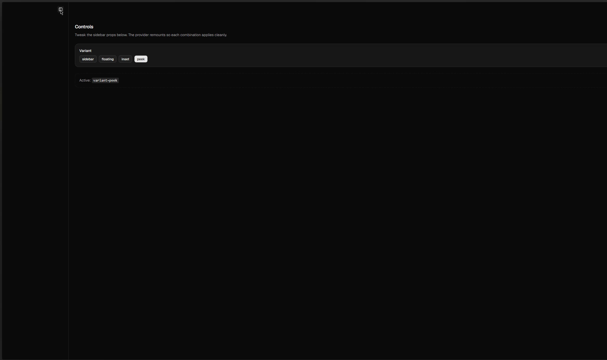

# sidebar

<p align="center">
  
</p>

Performant, fully collapsible **[shadcn/ui Base Sidebar](https://ui.shadcn.com/docs/components/base/sidebar)** (Base UI + Nova) with a **`peek`** variant: zero layout gap when collapsed, edge hover reveal via `transform`, and a shared trigger between page and sidebar headers. Install from the [shadcn registry](https://ui.shadcn.com/docs/registry) or use the monorepo package.

**Live preview:** https://kaori2499.github.io/sidebar/

## Install

```bash
bunx --bun shadcn@latest add kaori2499/sidebar/sidebar
bunx --bun shadcn@latest add kaori2499/sidebar/sidebar-playground
```

Requires a shadcn/ui project (Tailwind v4, Base Nova tokens). The `sidebar` item installs `components/ui/sidebar.tsx` plus `button`, `sheet`, `tooltip`, `input`, `separator`, `skeleton`, `use-mobile`, and `lib/utils.ts`. The playground block adds the interactive demo (`SidebarPlaygroundDemo`), Motion shared trigger, and peek-specific CSS.

After GitHub Pages has published the registry JSON, you can also use:

```bash
bunx --bun shadcn@latest add @sidebar/sidebar
bunx --bun shadcn@latest add @sidebar/sidebar-playground
```

(`@sidebar` → `https://kaori2499.github.io/sidebar/r/{name}.json` in this repo’s `components.json`.)

## Usage

**Registry playground block** (matches the preview above):

```tsx
import { SidebarPlaygroundDemo } from "@/components/blocks/sidebar-playground/sidebar-playground"
import "@/components/blocks/sidebar-playground/sidebar-playground.css"

export function App() {
  return <SidebarPlaygroundDemo />
}
```

**Sidebar only** in your own layout:

```tsx
import {
  Sidebar,
  SidebarInset,
  SidebarProvider,
  SidebarTrigger,
} from "@/components/ui/sidebar"

export function AppShell() {
  return (
    <SidebarProvider>
      <Sidebar variant="peek" collapsible="offcanvas">
        <SidebarTrigger />
        {/* … */}
      </Sidebar>
      <SidebarInset>
        <main>{/* … */}</main>
      </SidebarInset>
    </SidebarProvider>
  )
}
```

| `variant` | Behavior |
| --- | --- |
| `sidebar` | Default docked panel |
| `floating` | Inset card with shadow |
| `inset` | Main content inset with sidebar |
| `peek` | Fully collapsed (no gap); hover edge to slide in; `peekOpen` on `useSidebar()` |

| `collapsible` | When collapsed |
| --- | --- |
| `offcanvas` | Panel off-screen |
| `icon` | Icon rail |
| `none` | Not collapsible |

`variant="peek"` ignores `collapsible` for the hover/off-canvas behavior. Toggle with the trigger or **Ctrl/Cmd+B**.

## npm package (optional)

For the monorepo package without the CLI:

```bash
bun run build   # in this repo, or install from npm when published
```

```tsx
import {
  Sidebar,
  SidebarProvider,
  SidebarTrigger,
} from "@component-template/react"
import "@component-template/react/styles.css"
```

## Develop this repo

```bash
bun install
bun run dev          # playground at http://127.0.0.1:5174
bun run build        # packages/react → dist/
bun run typecheck
bun run test:e2e     # bunx playwright install chromium once
```

```bash
bun run registry:sync      # packages/react + playground → registry/
bun run registry:build     # sync + apps/playground/public/r/*.json for Pages
bun run registry:validate
```

## License

MIT — see [LICENSE](./LICENSE).

## Credits

Peek animation approach (transform instead of width/left):

- [Joshua Wootonn — Sidebar animation performance](https://www.joshuawootonn.com/sidebar-animation-performance)
